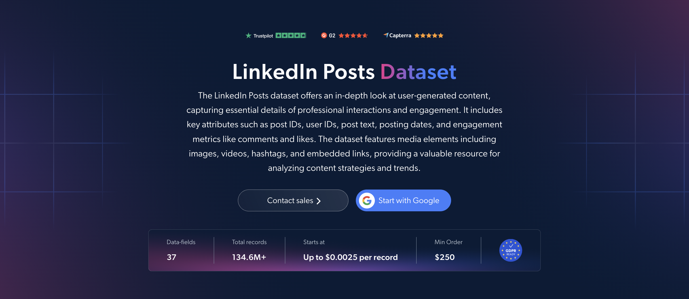

# LinkedIn-Posts-dataset-samples

<h2>A sample dataset of 1000 LinkedIn posts</h2>

<a href="https://brightdata.com/products/datasets/linkedin/posts">
   
</a>

A LinkedIn posts dataset sample of 1000 public posts. Dataset was extracted using the <b>Bright Data API</b>.

<h2>Some of the data points that are included in the dataset:</h2>

* ```url```: URL of the LinkedIn post
* ```id```: Unique identifier for each post
* ```title```: Title or main subject of the post
* ```headline```: Headline associated with the post
* ```post_text```: Main text content of the post
* ```post_text_html```: HTML-formatted post text
* ```date_posted```: Date and time the post was published
* ```post_type```: Content type, such as an article or post
* ```hashtags```: Hashtags used in the post
* ```embedded_links```: External links included in the post
* ```images```: Images attached to the post
* ```videos```: Videos attached to the post
* ```video_duration```: Duration of the attached video
* ```num_likes```: Number of likes received by the post
* ```num_comments```: Number of comments on the post
* ```top_visible_comments```: Publicly visible top comments, where available
* ```user_name```: Name of the post's author
* ```user_title```: Professional title of the author
* ```use_url```: URL of the author's LinkedIn profile
* ```user_followers```: Number of followers of the author
* ```account_type```: Whether the author is a person or company
* ```tagged_companies```: Companies tagged or mentioned in the post
* ```tagged_people```: People tagged or mentioned in the post
* ```repost```: Details of the original post that was reshared
* ```document_page_count```: Number of pages in an attached document

And a lot more.

This is a sample subset which is derived from the "LinkedIn Posts (public data)"
dataset which includes more than <b>134,600,000 posts</b>.

Available dataset file formats: <b>JSON, NDJSON, JSON Lines, CSV, XLSX, or Parquet. Optionally, files can be compressed to .gz</b>.

Dataset delivery type options: <b>Email, API download, Webhook, Amazon S3, Google Cloud storage, Google Cloud PubSub, Microsoft Azure, Snowflake, SFTP</b>.

Update frequency: <b>Once, Daily, Weekly, Monthly, Quarterly, Biannual, or Custom basis</b>.

Data enrichment available as an addition to the data points extracted: <b>Based on request.</b>

<b>[Get the full LinkedIn Posts dataset](https://brightdata.com/products/datasets/linkedin/posts)</b>.

<a href="https://brightdata.com/products/datasets/linkedin/posts">
</a>

<h2>What are the LinkedIn Posts datasets use cases?</h2>

<h3>1. Market research and competitor monitoring</h3>
Businesses analyze LinkedIn post text, hashtags and company mentions to identify industry topics and recurring themes. Comparing competitors' posts and engagement helps teams understand content strategies, follow product announcements and identify opportunities to differentiate their messaging.

<h3>2. Product feedback and customer insights</h3>
Product teams study public posts and visible comments about products and services to identify feature requests, recurring challenges and unmet needs. These insights support product research and help prioritize improvements based on feedback shared by professionals.

<h3>3. Thought leadership and content benchmarking</h3>
Marketers compare likes, comments and follower counts to identify authors and company pages whose content attracts engagement. Analyzing topics, publishing dates and content formats helps teams benchmark their own posts and refine their LinkedIn content strategy.

<h2>Free access to web scraping tools and datasets for academic researchers and NGOs</h2>

The Bright Initiative offers access to Bright Data's <b>[Web Scraper APIs](https://brightdata.com/products/web-scraper)</b> and <b>[ready-to-use datasets](https://brightdata.com/products/datasets)</b> to leading academic faculties and researchers, NGOs and NPOs promoting various environmental and social causes. You can submit an application <b>[here](https://brightinitiative.com)</b>.
